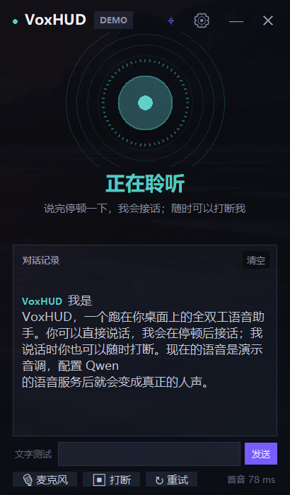

# VoxHUD · 豆包式全双工桌面语音助手

一个**尽可能轻量**的 Windows 桌面语音交互小窗：全局热键呼出，直接说话，说完自动接话；助手播报时你可以随时插话。ASR / TTS / LLM 均可替换，默认提供 Qwen（DashScope）适配器和完全离线的 Demo 模式。



## 为什么是 Python + Tkinter + WebRTC AEC

没有 Electron、没有浏览器运行时、没有前端构建链：

- **Tkinter**：Python 标准库，原生 Windows 小窗，启动快、内存小。
- **sounddevice/PortAudio**：一条 16 kHz 全双工流，输入输出共用时钟，AEC 参考信号天然对齐。
- **pywebrtc-audio**：直接使用 Chrome/Edge 同款 WebRTC AEC3 + NS + VAD；这是全双工 barge-in 能工作的关键。
- **websockets / httpx**：Qwen Realtime ASR/TTS 和 OpenAI-compatible 流式 LLM。
- **asyncio + 线程边界**：音频回调只做固定开销的 DSP；网络永远不在音频线程上。

源码运行时依赖约 45–50 MB（含 Tk/Tcl、PortAudio、WebRTC DSP、numpy），显著小于 Electron；PyInstaller 独立目录约 80 MB（含 Python 运行时与 Tcl/Tk）。

## 功能

- 全局热键 `Ctrl+Alt+Space` 呼出/隐藏，`Ctrl+Alt+X` 打断。
- 400×700 深色 HUD：状态球、实时波形、对话记录、首音延迟、静音、重试、设置。
- 全双工：麦克风持续输入；助手说话时用户持续说话 ≥ 阈值即 barge-in，立即停播、取消 LLM/TTS、回到聆听。
- 轮次管理：本地 VAD + 服务端 VAD + ASR final 融合；说完停顿后按可配置 hold 提交，用户继续说话会撤回候选。
- Qwen 接入：
  - ASR：`qwen3-asr-flash-realtime`（DashScope Realtime WebSocket）
  - TTS：`qwen3-tts-flash-realtime`，commit 模式，按句流式合成
  - LLM：任意 OpenAI-compatible `/chat/completions`，默认 `qwen-plus`
- Demo 模式：无需 API Key，本地脚本 ASR + 流式假 LLM + 音调 TTS，用于验证完整音频/打断/UI 链路。
- 输出状态定制：`idle/listening/thinking/speaking/interrupted/error` 六个状态的标题、提示、颜色、动画均可在设置页修改并即时生效。
- 单实例：重复启动会唤起已有窗口。
- 托盘：显示/隐藏、设置、静音、清空、退出（若系统策略导致托盘不可用，会自动改为关闭即退出）。
- 日志：`%APPDATA%\VoxHUD\logs\voxhud.log`，自动轮转，不记录 API Key。

## 快速开始

要求：Windows 10/11 x64，Python 3.10+（开发环境为 3.12）。

```powershell
# 1. 安装依赖（创建 .venv）
powershell -ExecutionPolicy Bypass -File scripts\setup.ps1

# 2. 启动（无控制台窗口）
powershell -ExecutionPolicy Bypass -File scripts\run.ps1

# 或者前台运行，便于看日志
powershell -ExecutionPolicy Bypass -File scripts\run.ps1 -Console
```

首次启动默认是 **Demo 模式**：直接说话即可看到“说话 → 思考 → 回答”的完整流程，但回答是本地脚本 + 音调语音，不是真正的人声。

本仓库还带有一个已验证的 PyInstaller 构建：`dist\VoxHUD\VoxHUD.exe`（约 80 MB 解压后），可直接双击运行，无需 Python 环境。

### 本仓库工作区直接运行

本工作区已经带了一份 `_vendor` 依赖，可直接：

```powershell
python run.py
```

（`run.py` 会自动把 `_vendor` 加入 `sys.path`；没有 `_vendor` 时使用当前 Python 环境。）

## 配置 Qwen

打开设置（齿轮图标），把“服务”切到 **Qwen（DashScope）**，填写 DashScope API Key，保存即可自动重连。也可以直接编辑：

`%APPDATA%\VoxHUD\config.json`（或用 `python run.py --config path\to\config.json`）

关键字段：

```json
{
  "provider_mode": "qwen",
  "dashscope": {
    "api_key": "sk-...",
    "region": "cn",
    "asr_url": "wss://dashscope.aliyuncs.com/api-ws/v1/realtime?model=qwen3-asr-flash-realtime",
    "tts_url": "wss://dashscope.aliyuncs.com/api-ws/v1/realtime?model=qwen3-tts-flash-realtime",
    "tts_voice": "Cherry",
    "language": "zh"
  },
  "llm": {
    "base_url": "https://dashscope.aliyuncs.com/compatible-mode/v1",
    "model": "qwen-plus"
  }
}
```

- 中国站默认域名：`dashscope.aliyuncs.com`
- 国际站：设置区域为“国际（新加坡）”，或把域名换成 `dashscope-intl.aliyuncs.com`
- API Key 也可通过环境变量提供：`DASHSCOPE_API_KEY`
- 连接自检：

```powershell
python scripts\check_qwen.py
```

详细字段与协议见 [docs/qwen-setup.md](docs/qwen-setup.md)。

> API Key 以明文保存在本机 JSON 中（与大多数本地语音客户端一致）。不要把配置文件提交到仓库；`.gitignore` 已忽略 `config.json`。

## 使用

| 操作 | 方式 |
| --- | --- |
| 呼出 / 隐藏 | `Ctrl+Alt+Space`，或托盘菜单，或再次启动 VoxHUD |
| 打断助手 | 直接说话；或 `Ctrl+Alt+X`；或界面“打断” |
| 静音麦克风 | 界面“麦克风”按钮 / `Ctrl+M` |
| 关闭窗口 | 隐藏到托盘（托盘不可用时退出） |
| 退出 | 托盘“退出 VoxHUD” / 标题栏关闭且未启用托盘隐藏 |

**建议佩戴耳机**。AEC 能显著抑制外放回声，但物理回声、房间混响和麦克风质量仍会影响 barge-in 阈值；可在设置里调“灵敏度”“打断保护”“最短语音”。

## 工作原理（简版）

```text
麦克风 16k ──► WebRTC AEC3/NS (far = 正在播放的 TTS) ──► VAD + RMS
                                      │
                                      ├─► Qwen ASR WebSocket（partial/final）
                                      │
                                      └─► TurnManager
                                             ├─ EndOfTurnDetector：停顿/标点/final → 提交
                                             └─ BargeInPolicy：持续语音 → 取消回答
                                                        │
LLM 流式文本 ──► SentenceChunker ──► Qwen TTS WebSocket ──► 16k 播放队列
                                                        │
                                                  speaker ──► AEC far 参考
```

关键点：

1. **barge-in 与 end-of-turn 是两套独立接口**。前者决定“是否打断”，后者决定“这轮是否说完”。
2. 每次取消都会递增 `epoch`；音频/文本回调携带 turn id，过期回调直接丢弃，避免旧回答“复活”。
3. TTS 按句提交，第一句音频不必等 LLM 全部生成。
4. 首音延迟会显示在界面右下角（从 EOT 提交到第一块 TTS 音频）。

更完整的设计见 [docs/architecture.md](docs/architecture.md) 和 [docs/turn-management.md](docs/turn-management.md)。

## 扩展点

所有扩展接口都在 `voxhud/providers/base.py` 和 `voxhud/turns/interfaces.py`：

```python
class AsrProvider(Protocol):
    async def start(self) -> None: ...
    def feed(self, pcm16: bytes) -> None: ...
    async def close(self) -> None: ...

class LlmProvider(Protocol):
    async def stream(self, messages, on_delta, cancel) -> str: ...

class TtsSession(Protocol):
    async def open(self) -> None: ...
    async def append(self, text: str) -> None: ...
    async def finish(self) -> None: ...
    async def abort(self) -> None: ...
```

替换 ASR/TTS 只需新增 `voxhud/providers/your_vendor.py`，并在 `build_providers()` 中加一个分支；TurnManager、音频、UI 不需要改动。

替换 end-of-turn / barge-in 策略同理：实现 `EndOfTurnDetector` / `BargeInPolicy` 协议即可。后续可接入语义 turn classifier、声学 barge-in 模型或 FireRedChat 的 turn detector。

## 测试

```powershell
powershell -ExecutionPolicy Bypass -File scripts\run_tests.ps1
# 或
python -m unittest discover -s tests -v
```

覆盖：

- EOT 候选、撤回、标点/语气词 hold、超长强制提交
- barge-in guard / 最短语音 / 冷却 / 安静语音
- TurnManager 状态迁移、epoch 取消、stale 回调
- 句子切分、Markdown 清理、配置合并/校验/持久化
- Qwen ASR/TTS 协议：本地假 WebSocket 服务验证 session.update、append、事件映射
- 对话集成：完整一轮、barge-in 取消半句回答

## 打包

```powershell
powershell -ExecutionPolicy Bypass -File scripts\build.ps1
# 产物：dist\VoxHUD\VoxHUD.exe
```

PyInstaller 会把 Tk/Tcl、PortAudio、WebRTC DSP 和音频设备模块一起收集。首次构建时间较长；`--onefile` 可用 `scripts\build.ps1 -OneFile`，但启动会慢一些。

创建开始菜单/开机启动快捷方式：

```powershell
powershell -ExecutionPolicy Bypass -File scripts\install-shortcut.ps1
powershell -ExecutionPolicy Bypass -File scripts\install-shortcut.ps1 -Startup
```

## 已知限制 / 后续方向

- Demo 模式是**音调**而非真人语音；真实语音请配置 Qwen TTS。
- 没有唤醒词：启动后持续监听；提供静音和隐藏行为配置。
- 首次外放使用时，建议让助手先说一句话以让 AEC 收敛；AEC 未收敛的约 300 ms 由 barge-in guard 保护。
- 目前是单会话、单助手；多会话、工具调用、打断后的上下文修复是下一步。
- Qwen Realtime 的具体配额/区域策略以阿里云控制台为准；不同账号可用模型可能不同。

## 目录

```
voxhud/
  audio/       全双工音频、AEC、VAD、PCM
  turns/       TurnManager / EOT / Barge-in 接口与实现
  providers/   Qwen ASR/TTS/LLM + Demo
  ui/          Tkinter HUD 与设置页
  platform/    Windows 热键、托盘、单实例、DPI
  conversation.py
  config.py
tests/
docs/
scripts/
```

## License

MIT. 见 [LICENSE](LICENSE)。
